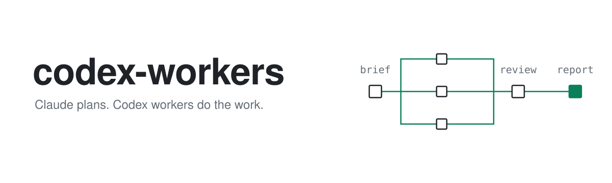
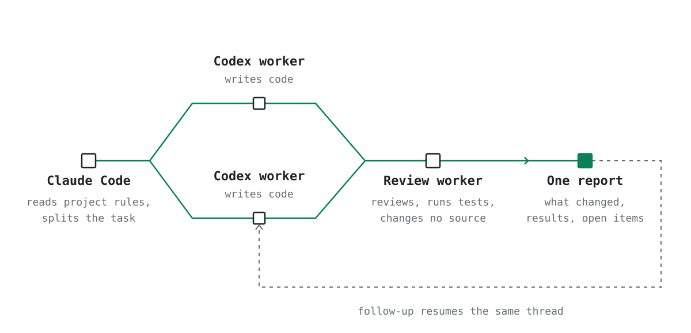

<picture>
  <source media="(prefers-color-scheme: dark)" srcset="assets/readme/hero-dark.svg">
  
</picture>

# codex-workers

A Claude Code plugin where Claude Code orchestrates and Codex workers write code, review changes, and run tests.

This is an independent community project, not affiliated with Anthropic or OpenAI.

## Why

- The orchestrator delegates the work; a separate worker reviews and tests after writing finishes.
- Project rules are read first. The workflow stops if they forbid delegation or require a particular model.
- Commits and external actions require an explicit request. Flags that disable the sandbox are prohibited.
- Follow-ups resume the same worker thread with its context preserved.

## Requirements

- Claude Code.
- Codex CLI logged in and on `PATH`.
- Node.js.
- `bash`, `pgrep`, and `sort -V` for the skill's commands.
- The OpenAI Codex plugin installed in Claude Code:

  ```text
  /plugin marketplace add openai/codex-plugin-cc
  /plugin install codex@openai-codex
  ```

## Install

In Claude Code:

```text
/plugin marketplace add opit80/codex-workers
/plugin install codex-workers@codex-workers
```

Manual installation (the same requirements apply):

```bash
git clone https://github.com/opit80/codex-workers.git
cp -r codex-workers/skills/codex-workers ~/.claude/skills/
```

## Usage

With the plugin:

```text
/codex-workers:codex-workers <task>
```

With the manual installation:

```text
/codex-workers <task>
```

Example:

```text
/codex-workers:codex-workers Fix the API's pagination so the final page returns the remaining records, add a regression test, and run the relevant tests. Do not commit.
```

The skill runs only when explicitly invoked (`disable-model-invocation: true`).
The default worker model is `gpt-6.1-sol` with `high` reasoning effort; name another model or effort in the task if needed.

The default Codex login is used; you may export `CODEX_HOME` yourself to use a separate Codex profile.

### Example run

Excerpts from a real run on a small demo repo, with the task "Fix pagination so the final partial page returns the remaining records, add a regression test, and run the tests. Do not commit."

The orchestrator starts a writing worker and then a separate review worker:

```text
Codex Task started in the background as task-mvyhpmm9-eyzzz9. Check /codex:status task-mvyhpmm9-eyzzz9 for progress.
Codex Task started in the background as task-mvyhq83z-hgfhqq. Check /codex:status task-mvyhq83z-hgfhqq for progress.
```

The writing worker's change:

```diff
-  const pages = Math.floor(items.length / size);
+  const pages = Math.ceil(items.length / size);
```

From the final report:

```text
Review/test worker. Verdict: ok.
Changed files: paginate.js, paginate.test.js (uncommitted, in the working tree).
My own final test command: npm test. Result: exit 0, prints ok.
Open items: invalid input (negative page, page 0, size 0) is still unvalidated and untested.
```

## How it works

<picture>
  <source media="(prefers-color-scheme: dark)" srcset="assets/readme/flow-dark.svg">
  
</picture>

1. The orchestrator reads project rules first and stops if they forbid delegation or require a particular model.
2. It briefs Codex workers and assigns independent work, using separate worktrees when needed to avoid file conflicts.
3. After writing finishes, a separate worker reviews the changes and runs tests with instructions not to change source.
4. The orchestrator runs the project's fastest test once and reports results in the user's language.

## What you get

A short final report:

- Work completed, with each package's worker, job id, thread id, and outcome.
- Changed files, including directory paths and branches when worktrees were used.
- Review findings and test/build results, with unverified results identified.
- The orchestrator's final test command and result.
- Open items, risks, and decisions needed from you.

## Limitations

- Developed and run on Linux with Codex plugin 1.0.6 and codex-cli 0.164.0. Other versions are unverified.
  The end-to-end run covered the writing worker, the review worker and the final report; resume, cancel, parallel workers, worktrees and the usage-limit path have not been exercised in this English version.
- Workers bypass the companion broker using `CODEX_COMPANION_APP_SERVER_ENDPOINT=unix:/nonexistent/no-broker.sock`.
  This relies on internal plugin behaviour that may break on updates; the orchestrator reports a plugin version mismatch.
- The skill relies on the internal plugin cache path `~/.claude/plugins/cache/openai-codex/codex/` and script `scripts/codex-companion.mjs`.
- macOS and Windows are not tested, and the commands assume `bash`.
- The default model `gpt-6.1-sol` must be available on your Codex plan. Otherwise, name another model in the task or edit `skills/codex-workers/SKILL.md`.
- Workers use your own Codex quota. On usage limits, the workflow stops the affected workers and reports their thread ids
  and the reset time, or states that no reset time was provided. It does not switch accounts, retry in a loop, or send probe requests.
  It does not wake itself: after the reset, ask it to continue, and it resumes the same threads.
- Keep the Claude Code session open while workers run. Ending the session or using `/clear` can kill jobs and remove their records.

## Issues

[Report an issue](https://github.com/opit80/codex-workers/issues) and include the Codex plugin version and `codex --version`.

## License

[MIT](LICENSE), Copyright (c) 2026 opit80.
